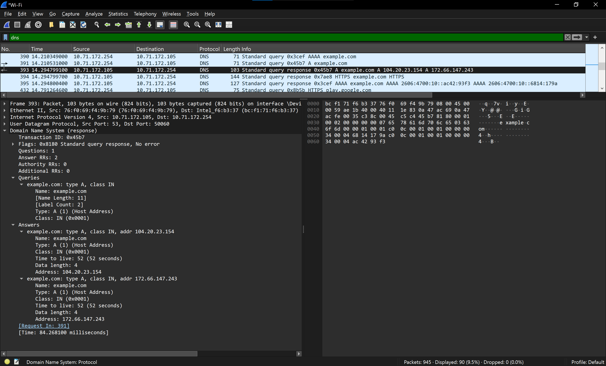
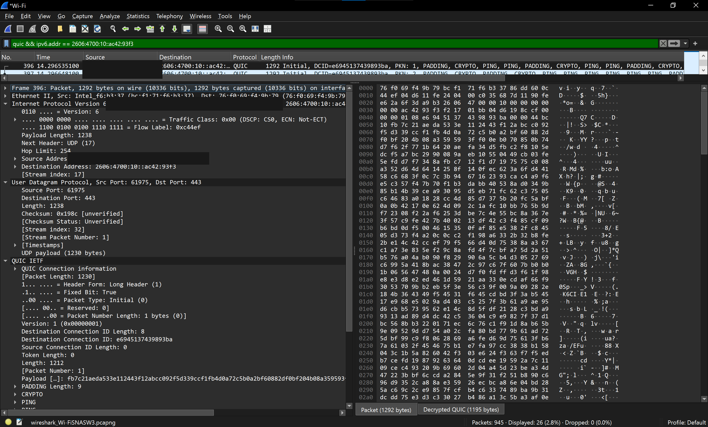
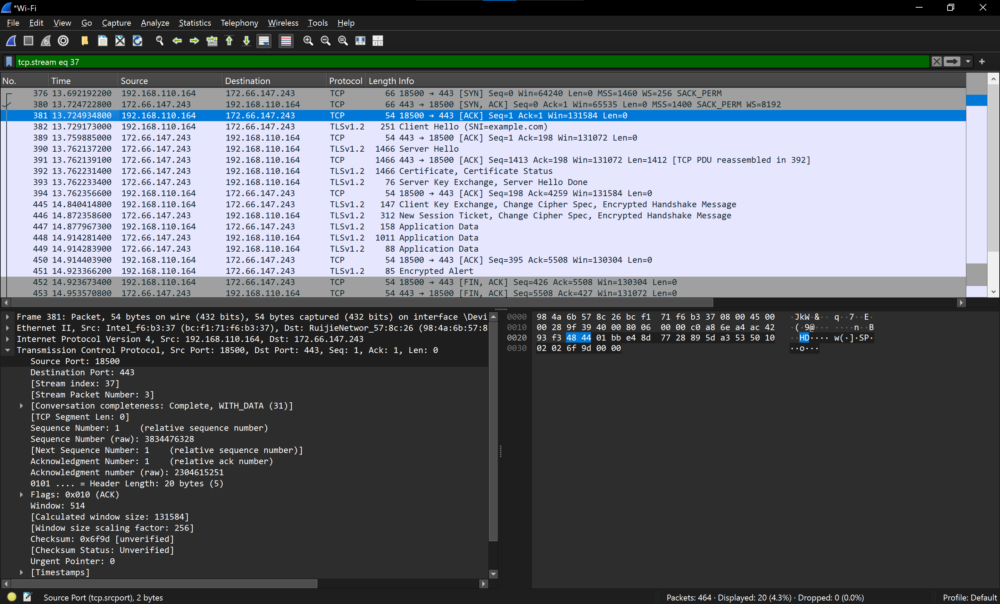
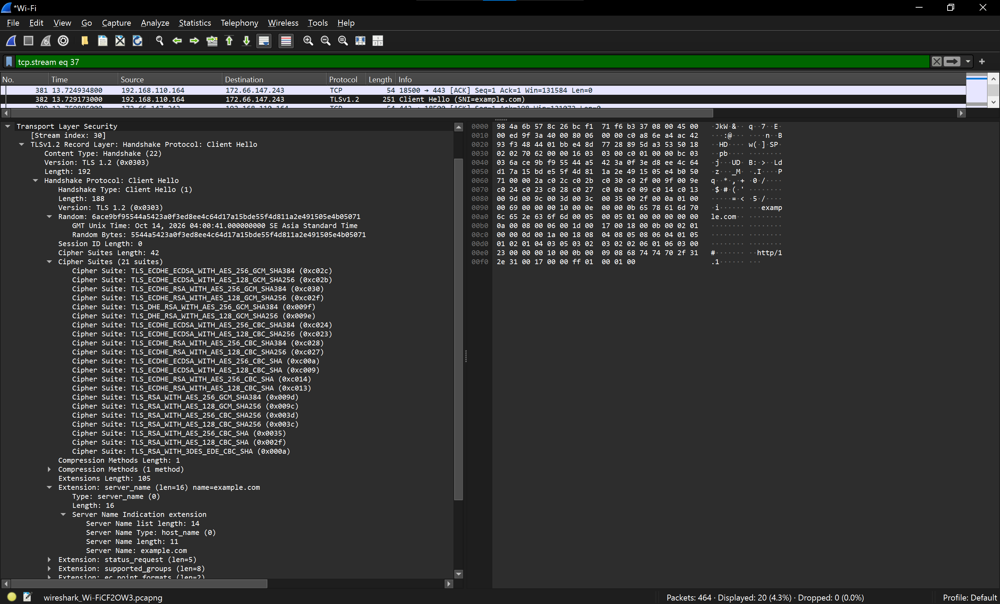
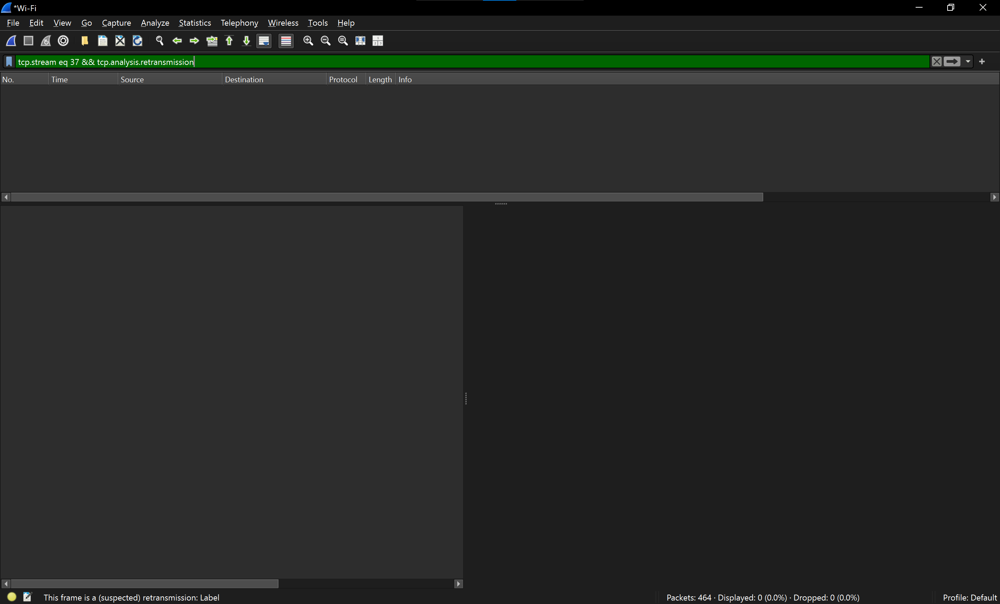
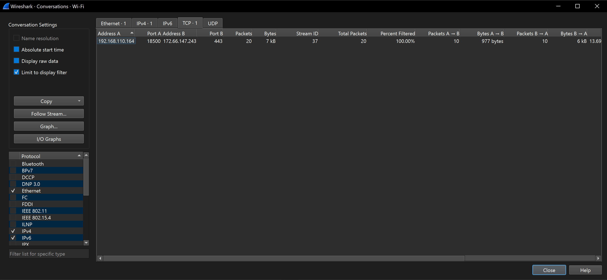
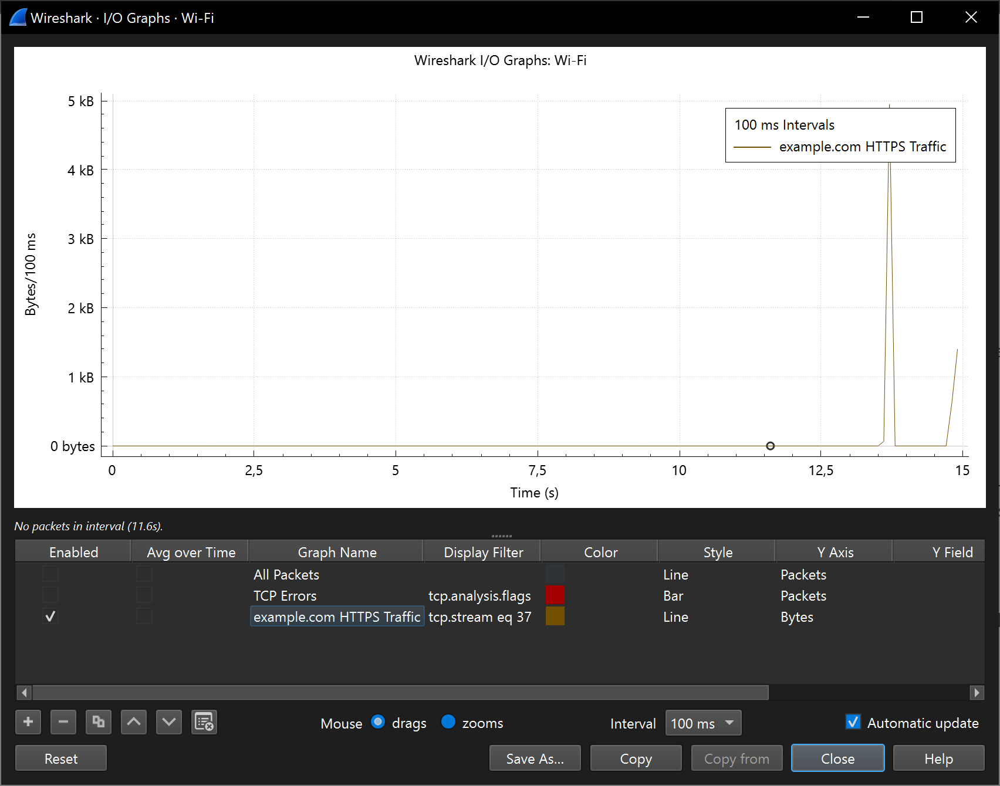

# Wireshark Network Traffic Analysis: DNS, QUIC, TCP & TLS

A hands-on network traffic analysis project using **Wireshark** to trace how a simple request to `example.com` moves from DNS resolution to modern QUIC traffic and a controlled TCP/TLS HTTPS session.

The project started as a DNS inspection exercise. During analysis, the browser was observed using **IPv6 + QUIC over UDP/443** instead of the expected IPv4/TCP path. A controlled `curl` test was then used to force **IPv4 + HTTP/1.1**, making it possible to inspect the TCP three-way handshake, TLS negotiation, encrypted application data, connection statistics, and retransmission behavior.

> **Privacy note:** Raw `.pcap/.pcapng` files are intentionally not published because packet captures can contain unrelated or sensitive traffic. The public IPv6 client address is redacted in the QUIC screenshot.

## Objectives

- Inspect DNS A and AAAA resolution for `example.com`.
- Identify the actual protocol path selected by a modern browser.
- Analyze QUIC traffic over IPv6 and UDP/443.
- Build a controlled IPv4/TCP/TLS session for comparison.
- Inspect the TCP three-way handshake and TLS Client Hello/SNI.
- Check for TCP retransmissions.
- Summarize the connection using Wireshark Conversations and I/O Graphs.

## Tools

- Wireshark
- Windows Command Prompt
- `curl.exe`
- `example.com` as the controlled public test target

## Methodology

### 1. DNS resolution

The DNS response for `example.com` returned two IPv4 addresses:

- `104.20.23.154`
- `172.66.147.243`

The observed DNS response time was **84.2681 ms**. The DNS exchange used **UDP/53**.



### 2. Browser traffic: IPv6 + QUIC

The browser did not immediately use either IPv4 address. Further inspection showed traffic to the IPv6 address `2606:4700:10::ac42:93f3` using **QUIC v1 over UDP/443**.

Observed QUIC packet stages included:

- Initial
- Handshake
- Protected Payload



This explained why an initial search for a TCP three-way handshake did not match the browser session: the browser had selected a QUIC-based path instead.

### 3. Controlled TCP/TLS test

To make the TCP/TLS flow deterministic, DNS cache was flushed and a new capture was started before running:

```powershell
ipconfig /flushdns
curl.exe -4 --http1.1 https://example.com/ -o NUL
```

The relevant HTTPS connection was isolated as **TCP stream 37**:

- Client: `192.168.110.164:18500`
- Server: `172.66.147.243:443`

The stream clearly showed:

1. SYN
2. SYN, ACK
3. ACK
4. TLS Client Hello
5. TLS Server Hello / certificate exchange
6. Encrypted Application Data
7. FIN/ACK connection termination

The observed TCP connection-establishment time was approximately **32.7 ms**.



### 4. TLS Client Hello and SNI

The TLS Client Hello advertised **21 cipher suites** and included the Server Name Indication extension:

```text
Server Name: example.com
```



The application payload appears as TLS Application Data because the HTTP traffic is encrypted rather than visible as plaintext HTTP.

### 5. TCP retransmission check

Filter used:

```text
tcp.stream eq 37 && tcp.analysis.retransmission
```

No packets matched the filter, so **no TCP retransmissions were detected in the analyzed HTTPS session**.



### 6. Conversation statistics

Wireshark Conversations reported:

| Metric | Result |
| --- | ---: |
| TCP stream | 37 |
| Total packets | 20 |
| Total traffic | ~7 kB |
| Client → Server | 10 packets / 977 bytes |
| Server → Client | 10 packets / ~6 kB |

Although packet counts were equal in both directions, most transferred bytes originated from the server.



### 7. I/O Graph

The I/O Graph was filtered to `tcp.stream eq 37`, measured in **bytes**, with **100 ms intervals**. Traffic was concentrated in a short period, with the largest observed burst reaching approximately **5 kB per 100 ms**.



## Key Findings

| Area | Finding |
| --- | --- |
| DNS | A and AAAA resolution successfully observed |
| DNS response time | 84.2681 ms |
| Browser path | IPv6 + QUIC v1 over UDP/443 |
| Controlled path | IPv4 + TCP/443 + TLS + HTTP/1.1 |
| TCP handshake | SYN → SYN/ACK → ACK |
| TCP establishment | ~32.7 ms |
| TLS SNI | `example.com` |
| TLS Client Hello | 21 advertised cipher suites |
| Retransmissions | None detected in TCP stream 37 |
| TCP conversation | 20 packets, ~7 kB |

## Useful Wireshark Filters

```text
# DNS traffic
dns

# IPv6 server observed in the browser session
ipv6.addr == 2606:4700:10::ac42:93f3

# QUIC traffic to the observed IPv6 server
quic && ipv6.addr == 2606:4700:10::ac42:93f3

# HTTPS over TCP
tcp.port == 443

# TCP packets with SYN set
tcp.flags.syn == 1

# Isolate the controlled HTTPS connection
tcp.stream eq 37

# Retransmissions within the controlled connection
tcp.stream eq 37 && tcp.analysis.retransmission
```

## Skills Demonstrated

- Packet capture and display filtering in Wireshark
- DNS query/response analysis
- IPv4 and IPv6 traffic inspection
- QUIC/UDP traffic identification
- TCP three-way handshake analysis
- TLS Client Hello, SNI, and encrypted traffic inspection
- TCP retransmission troubleshooting
- Conversation-level traffic statistics
- I/O Graph traffic visualization
- Troubleshooting unexpected protocol behavior by designing a controlled comparison test

## Repository Structure

```text
.
├── README.md
├── assets/
│   └── screenshots/
│       ├── 01-dns-resolution.png
│       ├── 02-quic-ipv6-analysis-redacted.png
│       ├── 03-tcp-tls-session-overview.png
│       ├── 04-tls-client-hello-sni.png
│       ├── 05-tcp-retransmission-check.png
│       ├── 06-tcp-conversation-statistics.png
│       └── 07-tcp-stream-io-graph.png
├── docs/
│   ├── analysis-notes.md
│   └── reproduction-guide.md
└── .gitignore
```

## Scope and Limitations

This is a small controlled learning project, not a comprehensive network-performance or security audit. The observations describe the captured sessions only. In particular, the absence of retransmissions in TCP stream 37 does not imply that the wider network was loss-free, and individual I/O Graph spikes are not attributed to a specific protocol message without packet-level timestamp correlation.
